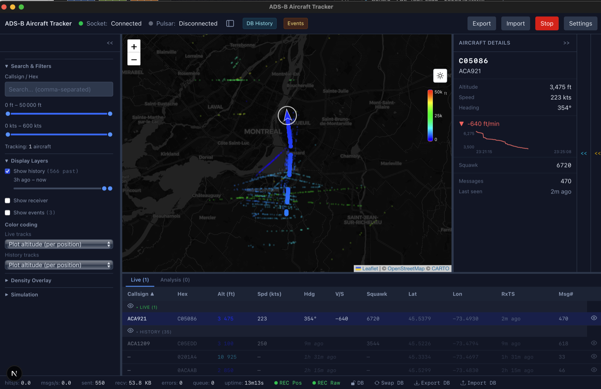
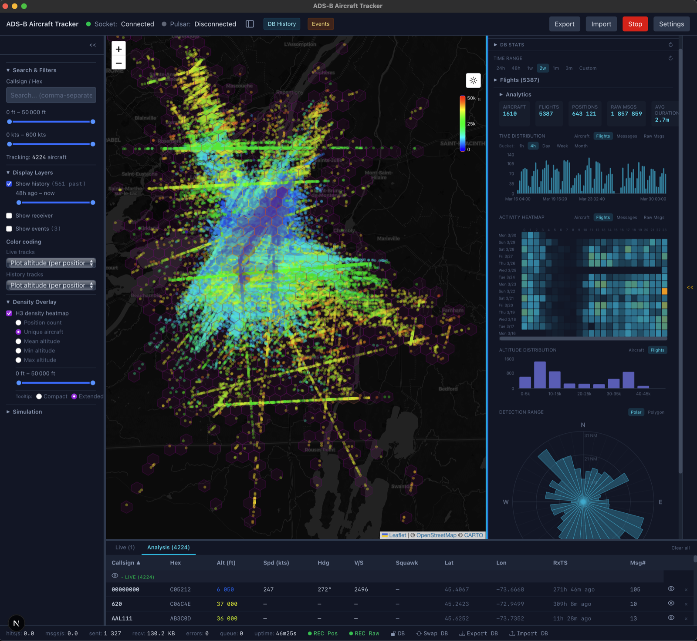
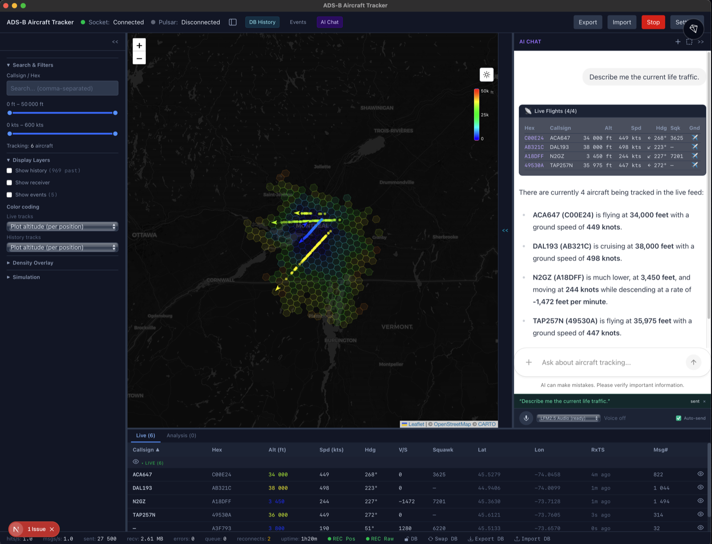
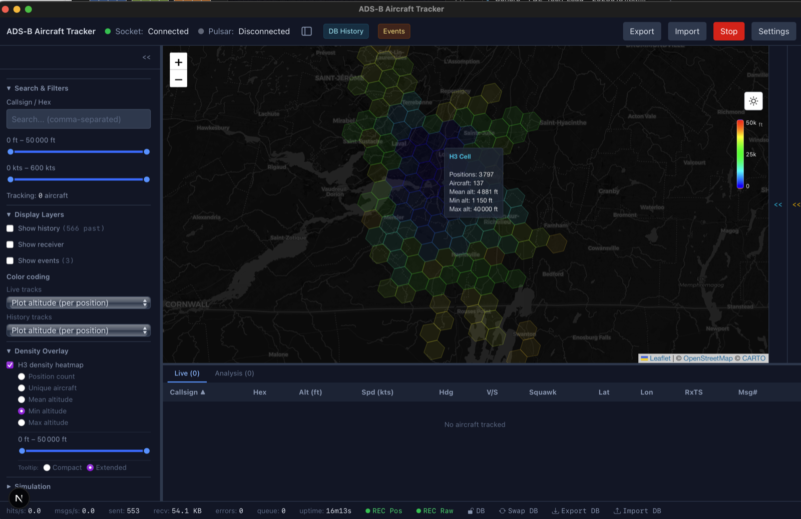
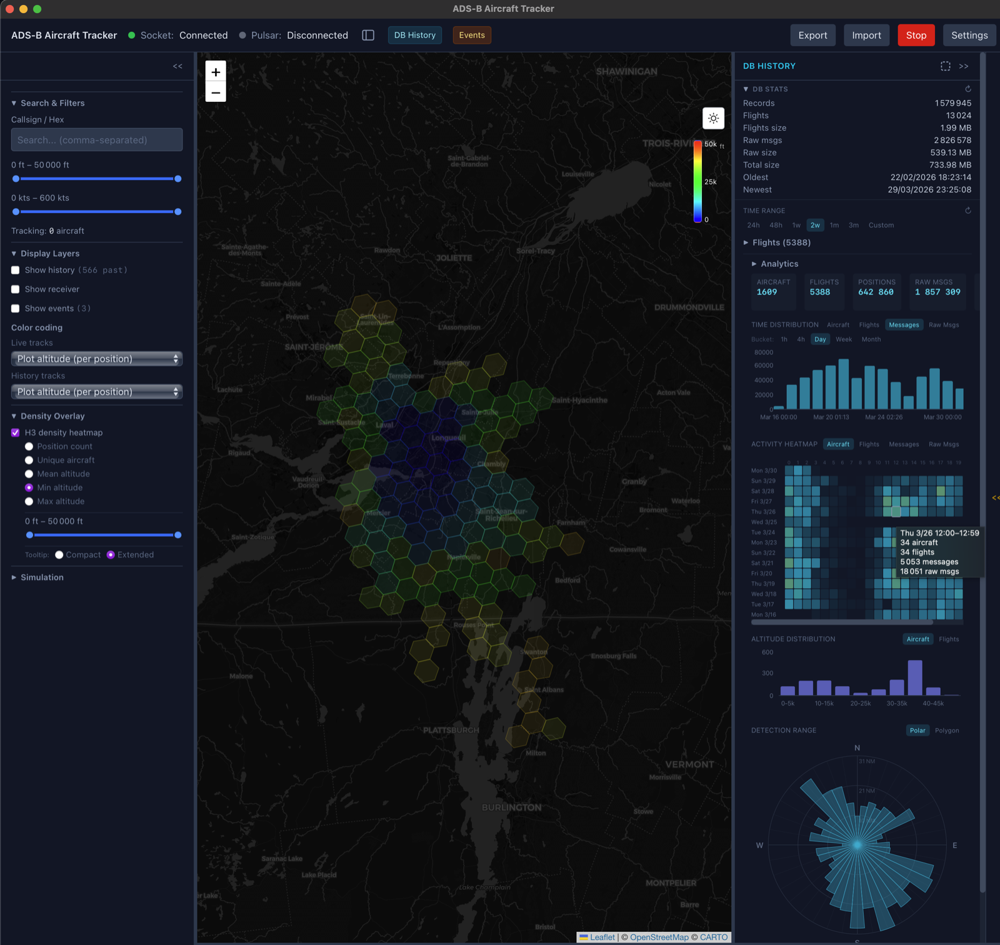

# ADS-B Feed

Captures aircraft positions from a dump1090 receiver, moves them over an MQTT edge bus,
records them in DuckDB, and shows them live and historically in a Tauri desktop app with
AI agents on top. An optional Pulsar leg feeds the separate Spark/Delta analytics pipeline.

| Flight Details & Short History | DB History & Analytics | AI Chat |
|:---:|:---:|:---:|
| <a href="rust/adsb-pulsar-client-desktop/docs/screenshots/adsb-tracker-flight-details-short-history.png"></a> | <a href="rust/adsb-pulsar-client-desktop/docs/screenshots/adsb-tracker-dbhistory-analytics.png"></a> | <a href="rust/adsb-pulsar-client-desktop/docs/screenshots/adsb-feed_chat-ai_2026-06-07.png"></a> |

| H3 Density Details | H3 Density Statistics |
|:---:|:---:|
| <a href="rust/adsb-pulsar-client-desktop/docs/screenshots/adsb-tracker-h3-density-details.png"></a> | <a href="rust/adsb-pulsar-client-desktop/docs/screenshots/adsb-tracker-h3-density-statistics.png"></a> |

<sub>Click a screenshot for the full-size image.</sub>

## Architecture Overview


Read the diagram from the bottom up. **dump1090** emits SBS-1 lines, which the **feed
client** publishes to **MQTT**. The **data server** subscribes and records them in **DuckDB**,
then serves that history over Quack. The **desktop app** takes the live feed from MQTT and its
history from the data server. For **voice input**, the desktop's mic button drives `adsb-agent`,
which records from the host microphone and transcribes locally through an LFM2.5-Audio
`llama.cpp` server that it starts itself. The resulting text enters the chat like a typed
prompt. Dashed boxes are optional or off by default: the weather
service, and the Pulsar → Spark → Delta Lake → webapp path, which lives outside this repo
(`../spark-adsb`, `../webapp`). Ports shown are the defaults from
[`adsb-stack-template.toml`](adsb-stack-template.toml).

### Compact mode: the desktop app embeds the services


The desktop app can also run with nothing else around it. With its defaults
(`source_kind = socket`, embedded storage), it reads dump1090 directly over TCP and records
to its own `adsb_history.db` inside the app-data directory. One Tauri process covers the
feed client, recorder and storage, so there is no broker, data server or Docker. The
in-process **tool server** keeps the AI agents working against that local database.

What you give up: recording stops when the app closes, and the weather layer is unavailable
because its snapshots only arrive over MQTT. To start it, run `npm run tauri dev` from
[`rust/adsb-pulsar-client-desktop/`](rust/adsb-pulsar-client-desktop/README.md). Settings
switches it to the MQTT topology later.

## Repository Structure

### `infrastructure/`

Deployment and operational tooling for the supporting services:

| Path | Description |
|------|-------------|
| `mqtt/` | Mosquitto broker (Compose file + `mosquitto.conf`) — the live transport, started by `make up` |
| `docker-compose.yml` | Optional Pulsar broker (+ init) with Prometheus and Grafana monitoring |
| `docker-compose.pi.yml` | Raspberry Pi override: Prometheus on the host network, so loopback-bound services need not open their ports |
| `DockerCompose/pulsar/` | Pulsar consumer test script |
| `grafana/` | Dashboards (pipeline, recorder, weather, agents) and auto-provisioning of the Prometheus datasource |
| `prometheus/` | Prometheus scrape configuration (`prometheus.yml`, plus `prometheus.pi.yml` for the Pi) |
| `Spark/` | Dockerfile for Spark + Delta Lake experimentation |
| `kubernetes/` | Spark standalone cluster + S3-compatible store for `spark-adsb` — Kustomize `base/` with per-version `overlays/`, or the `helm/adsb-spark` chart |
| `pulsar/` | Pulsar setup scripts (standalone broker, topic config, monitoring) |

Pulsar is optional and off by default; see [`QUICKSTART.md`](QUICKSTART.md) for running the
MQTT stack and [`infrastructure/README.md`](infrastructure/README.md) for details.

### `rust/`

Higher-performance and desktop components (Cargo workspace):

| Crate / Directory | Description |
|-------------------|-------------|
| `adsb-pulsar-client/` | Feed client library + CLI binary: reads dump1090 SBS-1 and publishes to MQTT, with Pulsar as an optional extra leg (the name predates MQTT) |
| `adsb-data-engine/` | Shared SBS-1 parser, geo utilities, and DuckDB local storage |
| `adsb-data-server/` | Headless recorder: subscribes over MQTT, writes DuckDB, serves it over Quack and a read-only HTTP query API |
| `adsb-weather-server/` | Optional weather service: gridded winds aloft and MSL pressure from Open-Meteo, published as a retained MQTT snapshot |
| `adsb-pulsar-client-desktop/` | Tauri v2 desktop app (Rust backend + Next.js 16 / React 19 frontend) |
| `adsb-agent/` | AI agent layer (LangGraph ReAct loop, AG-UI chat, voice/audio models) — Python, not a Cargo member |
| `adsb-simulation-agent/` | A2A agent generating kinematically plausible simulated trajectories — Python, not a Cargo member |

See [`rust/README.md`](rust/README.md) for detailed setup, build commands, and crate documentation.

### Flight simulation

The desktop app can fly **simulated aircraft** described in plain language
("police helicopter circling the old port"): `adsb-agent` (:8000) proxies the request
over A2A to `adsb-simulation-agent` (:8300), which returns timed waypoints respecting
real flight-dynamics limits. Trajectories play back per aircraft and can be saved as
named scenarios that replay offline. Both Python services are optional.

See the [simulation agent README](rust/adsb-simulation-agent/README.md) and the
[desktop app README](rust/adsb-pulsar-client-desktop/README.md).

### `deploy/`

Fleet configuration for **deployed nodes**: Raspberry Pis running systemd units,
configured under `/etc/adsb/`. This is separate from `adsb-stack.toml`, which
configures the development stack on this machine.

| Path | Description |
|------|-------------|
| `fleet-template.toml` | Tracked template. Copy it to `<stage>.toml` (gitignored) and fill in hostnames, ids and the share token |
| `.rendered/<node>/` | Gitignored per-node configs produced by `make render-fleet F=deploy/<stage>.toml`; `make deploy` ships from here |

One file per stage, not per node. The values that must agree across hosts
(`source_id`, `mqtt_topic`, `share_token`) are written once, because a mismatch
fails silently. See [`deploy/README.md`](deploy/README.md) and
[`rust/docs/DEPLOYMENT.md`](rust/docs/DEPLOYMENT.md).

### `scripts/`

Tooling behind the root `Makefile`. Run `make` to list targets. You normally go
through `make` rather than calling these directly:

| Script | Description |
|--------|-------------|
| `stack.sh` | Starts, stops and inspects the local stack (`make up`, `down`, `verify`, `doctor`, ...). Kills only the PIDs it started |
| `render-config.py` | Expands `adsb-stack[-<name>].toml` into per-binary configs under `.run/` (or `.run/<name>/` with `STACK=<name>`), and renders fleet configs for `deploy/` |
| `tauri-dev-config.py` | Emits the `tauri dev -c` override (ports, CSP) that lets a second named stack run its own desktop instance |
| `install-skills.sh` | Symlinks `skills/*` into `.claude/skills/` (`make skills`) |
| `tests/` | Tests for the tooling itself: config rendering, stack paths, metrics, weather |

### `skills/`

Claude Code skills for operating this repo, kept in a tracked directory because
`.claude/` is gitignored. Run `make skills` once per checkout to link them in.
They are links, not copies, so edits take effect immediately.

| Skill | Description |
|-------|-------------|
| `run-adsb-stack/` | Configure, launch, verify and stop the local stack (broker, feed, data server, desktop, agents), or point the desktop at a remote data server |
| `run-adsb-desktop/` | Build, launch and verify the Tauri desktop app on macOS, with a mock dump1090 and verification helpers |

### `graphify-out/`

A navigable knowledge graph of this codebase produced by [graphify](https://github.com/safishamsi/graphify).

**Only the non-regeneratable sources are tracked** — `graph.json`, the semantic extraction
cache (`cache/semantic/`), `manifest.json` (the incremental-update baseline),
`.graphify_labels.json`, and `cost.json`. Everything that regenerates for free is **git-ignored**:
the AST cache (`cache/ast/`), the derived views (`graph.html`, `GRAPH_TREE.html`, `GRAPH_REPORT.md`),
per-session query `memory/`, and machine-local dotfiles.

**Regenerating the ignored files** (after cloning, or any time they are missing):

```bash
cd adsb-feed
# AST cache + graph.json + GRAPH_REPORT.md — re-parses changed code, no LLM/API cost
graphify update .
# Derived HTML views from the existing graph.json
graphify export html
```

`graphify update .` diffs against the tracked `manifest.json`, so it only re-extracts changed
files. To rebuild the semantic layer from scratch (requires an LLM backend — a cloud key or a
local endpoint such as Ollama/LM Studio via `OLLAMA_BASE_URL`), run the full pipeline with `/graphify .`.

